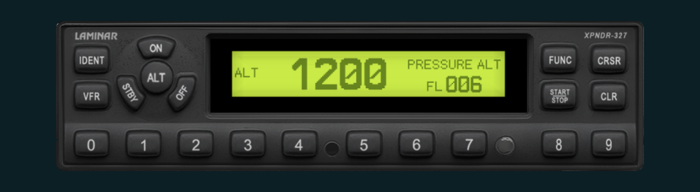
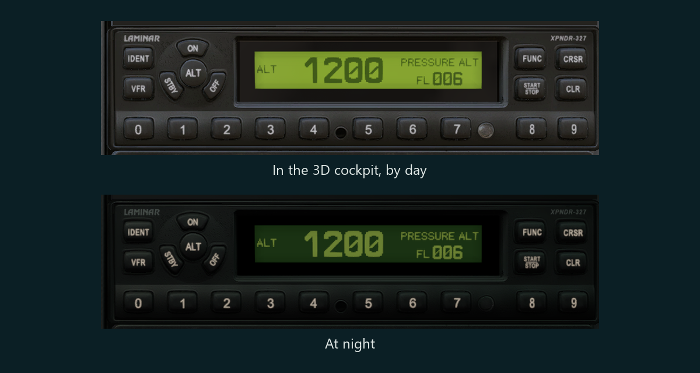
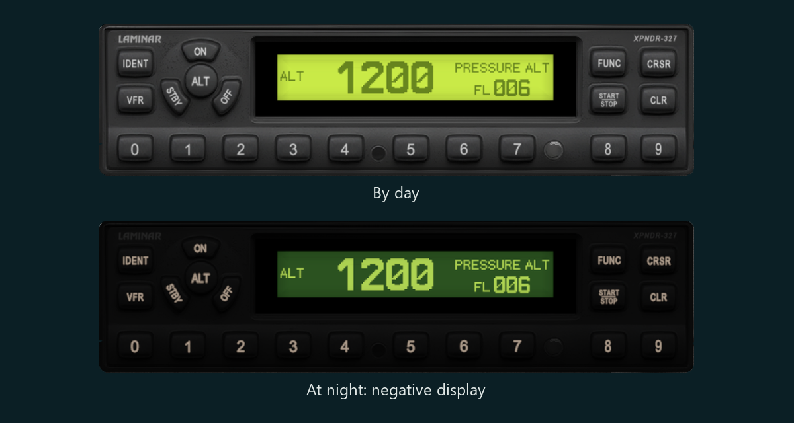
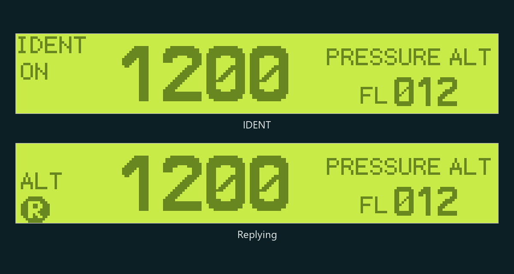
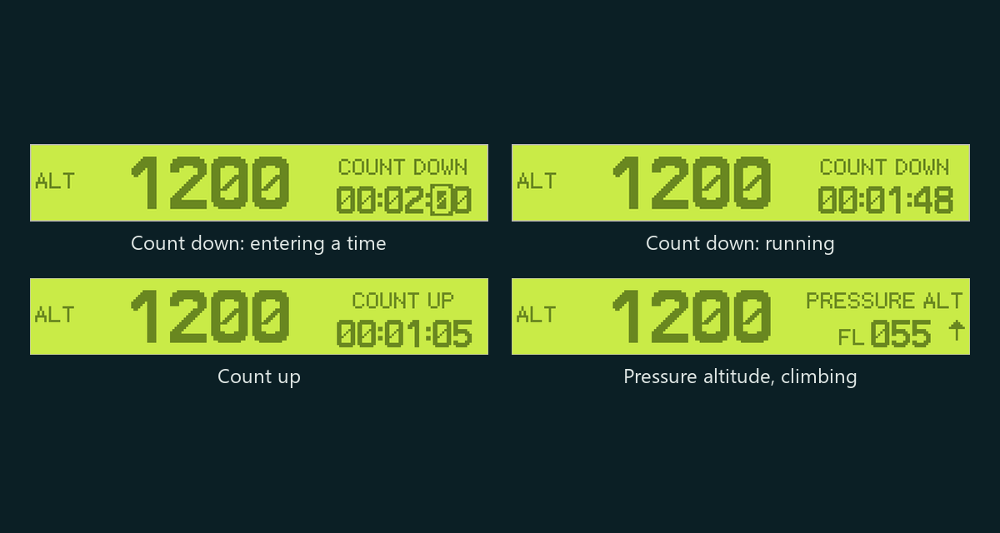
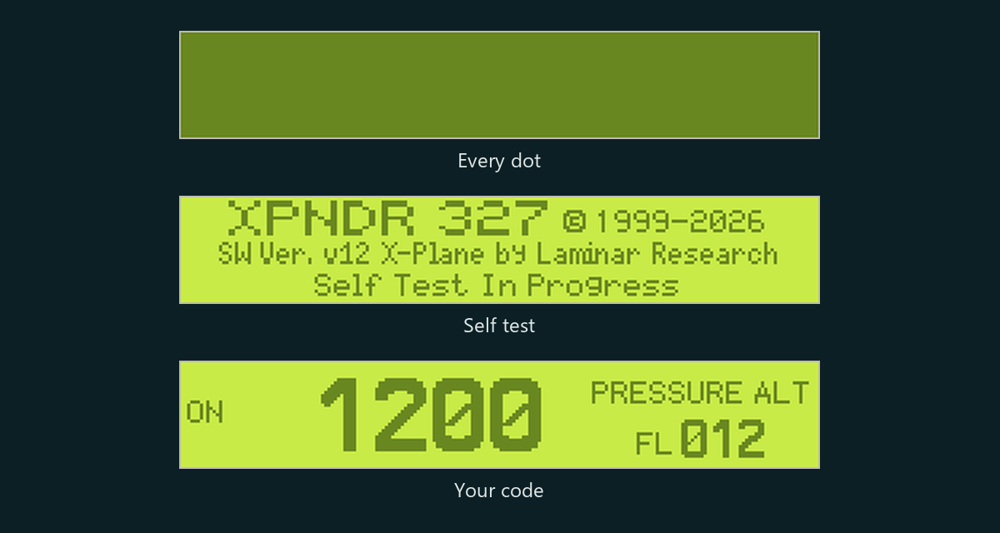
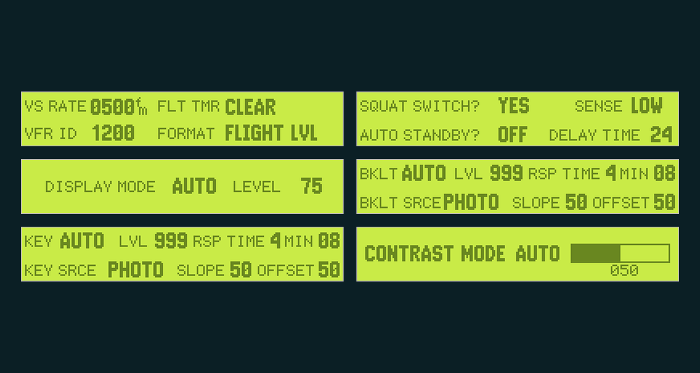

# GTX 327 for X-Plane 12

The Garmin GTX 327 Mode A/C transponder, rebuilt for X-Plane 12.

One dot-matrix LCD, twenty keys, and the pages from Garmin's own manuals, drawn dot for dot.

<p align="center"></p>

## A quick look

<table>
<tr>
<td width="50%"><br>
<sub>Click the 3D keys right in the cockpit. No need to give up your cockpit object for it.</sub></td>
<td width="50%"><br>
<sub>Normal by day. At night the display turns negative on its own, as the real one does.</sub></td>
</tr>
<tr>
<td><br>
<sub>IDENT holds for 18 seconds. The ® lights up whenever the transponder replies.</sub></td>
<td><br>
<sub>Count up, count down, and an arrow for which way the altitude is going.</sub></td>
</tr>
<tr>
<td><br>
<sub>Power it up: every dot lit, the self test, then the code you left it on.</sub></td>
<td><br>
<sub>Yes, the installer's configuration mode is in there too. 8 pages, saved straight to the ini.</sub></td>
</tr>
</table>

## Read the manual

Everything lives in **[GTX327_Manual.pdf](GTX327_Manual.pdf)**: flying it, installing it, every setting,
command and dataref, a first-flight tutorial, and where it differs from the real unit.

This README stays short on purpose. One place to update, one place to look.

## What you get

- OFF, STBY, ON and ALT, with AUTO STANDBY (shipped off) and the landing delay
- Codes entered the real way, with the 0-7 keys, CLR, CRSR and VFR
- Pressure altitude with its trend arrow; flight timer, count up and count down
- A self test at every power-up, and a unit that remembers its last code, mode and levels
- A photocell or panel-dimmer backlight, lit key legends, and the negative night display
- The installer's configuration mode, writing its changes into `gtx327_config.ini`
- The 3D unit and a pop-up, both live. Your existing transponder bindings keep working
- `Log.txt` lines that say what went wrong and who fixes it (written for you or your AI agent)

## Quick start (aircraft authors)

1. Copy `scripts/custom_device_GTX327/` to `<aircraft>/plugins/xlua/scripts/`. The zip on the
   [Releases](../../releases) page holds just this folder.
2. In Plane Maker, **Standard > Objects**, add two ordinary objects at the same position and rotation:
   `../plugins/xlua/scripts/custom_device_GTX327/3D/GTX327.obj` and
   `../plugins/xlua/scripts/custom_device_GTX327/3D/GTX327_screen.obj`.
   Set lighting to Inside and shadow mode to Interior Only.
3. In `gtx327_config.ini`, check `[Power]`: the bus that feeds it, and whether it waits for the
   avionics master.
4. Go fly.

Replacing a stock transponder, commands and VR, updating to a new version, and what each `Log.txt`
line means: manual, *Installation and Settings*.

**Needs** X-Plane 12.4.4 or later, and XLua 2.0.0-r1 or later in the aircraft's `plugins/xlua/`
(not included; get it from the [XLua repository](https://github.com/X-Plane/XLua)).
Tested on Windows only; macOS and Linux were checked by reading the code.

**Before you ship your aircraft**
- Make sure the folder has no `gtx327_pilot.ini`. That is the pilot's memory, written at run time.
- The model is about 8.6 % wider than the real unit, to fit the Laminar C172 radio stack.
- The pop-up and the screen are not meant for full screen, a second monitor or home-cockpit hardware.

**Ready to use.** Everything an aircraft needs is set in `gtx327_config.ini`; you should not need to
touch the scripts or the art. The MIT license still lets you. If something does not work, or you
need something it does not do, please open an [Issue](../../issues).

## Under the hood

- Drawn live with X-Plane's Panel Graphics through XLua 2, on a grid of 200 x 33 LCD dots.
- The characters were matched dot for dot to the screens in Garmin's manuals.
- X-Plane only clicks the cockpit object, so the 3D keys are clicked by a ray test of our own
  (`gtx327_pick.lua`), shared with the G5 and GI 275 packages.
- The GTX 327 takes over X-Plane's `sim/transponder/*` commands and its transponder code and mode.
- The key legends glow warm white, from the same dimmer and ambient light as the screen.

Behaviour follows Garmin's GTX 327 *Pilot's Guide* 190-00187-00 Rev D and *Installation Manual*
190-00187-02 Rev N.

## Files

```
scripts/custom_device_GTX327/
  custom_device_GTX327.lua   master script: power, modes, keys, timers, the LCD, datarefs, commands
  gtx327_setup.lua           configuration mode and gtx327_config.ini
  gtx327_raster.lua          LCD font data (generated)
  gtx327_pick.lua            3D key clicks
  gtx327_config.ini          the installation settings, documented line by line
  xpndr_GTX327_2d*.png       the pop-up's face
  3D/                        GTX327.obj (unit and keys), GTX327_screen.obj (display) and textures
GTX327_Manual.pdf            the manual
docs/gallery/                the pictures above
```

Version 18 (`Log.txt` shows `[GTX327] OK version 18`).

## Credits

GTX 327 for X-Plane, by Tiezheng Eric Xu for Laminar Research. 3D model and textures by Massimo
Durando. LCD fonts from [Avionic Fontbook](https://github.com/erix174/Avionic-Fontbook) by erix174.
Behaviour per Garmin's manuals listed above; the manuals are not included.

Garmin and GTX are trademarks of Garmin Ltd. or its subsidiaries. This project is not affiliated
with or endorsed by Garmin.

## License

MIT; see [LICENSE](LICENSE). The 3D model and textures are by Massimo Durando and are released
under the same MIT license.
